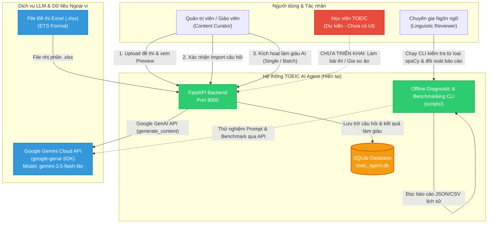
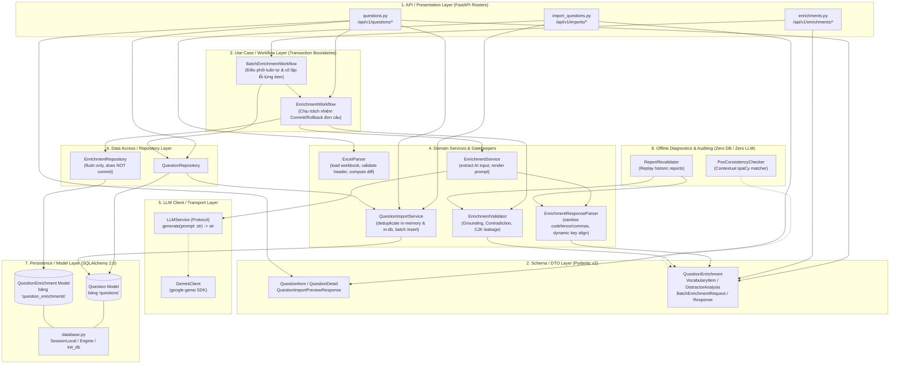

# Kiến trúc Hệ thống & Thành phần Thực tế (System Architecture)

> **File:** `docs/system-analysis/architecture.md`  
> **Phương pháp phân tích:** Reverse engineering cấu trúc package, module, class và nguyên lý phụ thuộc thực tế từ mã nguồn.

---

## 1. System Context Diagram (Bối cảnh Hệ thống)

Sơ đồ ngữ cảnh thể hiện vị trí của TOEIC Agent trong hệ sinh thái tương tác với người dùng và các dịch vụ bên ngoài:

---

## 2. Component & Layer Architecture (Kiến trúc Phân tầng Thực tế)

Mã nguồn của hệ thống tuân thủ mô hình phân tầng hướng use case (Layered Clean Architecture). Không tìm thấy các controller monolithic; các luồng nghiệp vụ được tách bạch thành router, workflow, service, validator, repository và model:

---

## 3. Phân tích Chi tiết Từng Layer trong Codebase

### Layer 1: API / Presentation Layer
- **Vị trí file:** `app/api/import_questions.py`, `app/api/questions.py`, `app/api/enrichments.py`.
- **Trách nhiệm thực tế:**
  - Định nghĩa router FastAPI (`APIRouter`), URL prefix, tags OpenAPI, status code HTTP.
  - Nhận HTTP Request (multipart/form-data cho Excel, JSON payload cho batch, query parameters cho lọc/phân trang).
  - Khai báo dependency injection: `Depends(get_db)`, `Depends(get_enrichment_workflow)`, `Depends(get_batch_enrichment_workflow)`.
  - Ánh xạ các ngoại lệ tầng dưới (`ExcelImportError`, `LLMAuthenticationError`, `LLMConnectionError`, `LLMTimeoutError`, `LLMProviderError`, `EnrichmentValidationError`, `EnrichmentQualityError`, `IntegrityError`) thành các mã HTTP tương ứng (400, 401, 404, 409, 500, 502, 503, 504).
- **Ranh giới:** Router tuyệt đối không trực tiếp mở transaction, không gọi `session.commit()` hay tương tác raw SQL. Router chỉ phụ thuộc vào các domain exceptions từ `app/services/llm_client.py` chứ không phụ thuộc trực tiếp vào vendor SDK.

### Layer 2: Schema / DTO Layer
- **Vị trí file:** `app/schemas/question.py`, `app/schemas/enrichment.py`.
- **Trách nhiệm thực tế:**
  - Định nghĩa cấu trúc dữ liệu truyền tải (DTO) sử dụng Pydantic v2:
    - `QuestionItem`: Schema câu hỏi đầu vào (validate `correct_answer` chỉ thuộc A, B, C, D; chuẩn hóa `str_strip_whitespace`).
    - `QuestionDetail`, `QuestionWithEnrichmentResponse`: Schema phản hồi thông tin câu hỏi.
    - `QuestionImportPreviewResponse`, `QuestionPreviewItem`, `QuestionChangeComparison`: Schema phục vụ đối soát và hiển thị preview diff.
    - `QuestionEnrichment`: Schema làm giàu sư phạm nghiêm ngặt (`extra="forbid"`, taxonomy 16 nhãn từ loại `VALID_PARTS_OF_SPEECH`).
    - `BatchEnrichmentRequest`, `BatchEnrichmentResponse`: Schema xử lý danh sách ID câu hỏi.
- **Ranh giới:** Không chứa logic truy vấn cơ sở dữ liệu.

### Layer 3: Use Case / Workflow Layer
- **Vị trí file:** `app/services/enrichment_workflow.py`, `app/services/batch_enrichment_workflow.py`.
- **Trách nhiệm thực tế:**
  - **`EnrichmentWorkflow` (Đơn câu):** Là thành phần **duy nhất sở hữu ranh giới Transaction (Transaction Boundary Owner)** cho tác vụ làm giàu AI:
    1. Kiểm tra tính Idempotent: Nếu câu hỏi đã có enrichment trạng thái `COMPLETED` và `force=False`, lập tức trả về bản ghi cũ mà không tốn chi phí gọi LLM.
    2. Gọi `EnrichmentService.enrich_question(question)` sinh nội dung AI.
    3. Chạy `EnrichmentValidator.validate_and_raise(...)` để kiểm định chất lượng cứng.
    4. Gọi `EnrichmentRepository.save_enrichment(...)` để flush vào session.
    5. Thực hiện `session.commit()` nếu thành công; tự động `session.rollback()` nếu bất kỳ lỗi nào xảy ra ở bước 2, 3, 4.
  - **`BatchEnrichmentWorkflow` (Hàng loạt):**
    - Điều phối xử lý tuần tự từng câu hỏi trong danh sách (sequential execution, không dùng thread pool hay Celery/background task).
    - Ủy quyền toàn bộ việc xử lý và transaction cho `EnrichmentWorkflow`.
    - **Cô lập lỗi độc lập (Failure Isolation):** Khi một câu hỏi gặp lỗi (LLM timeout, validation failed, DB integrity conflict), workflow bắt exception, ghi nhận status `"FAILED"` kèm chi tiết lỗi và tiếp tục xử lý các câu tiếp theo, không làm hủy các câu đã commit thành công trước đó.

### Layer 4: Domain Service Layer
- **Vị trí file:** `app/services/excel_parser.py`, `app/services/question_import_service.py`, `app/services/enrichment_service.py`, `app/services/enrichment_response_parser.py`, `app/services/enrichment_validator.py`.
- **Trách nhiệm thực tế:**
  - `ExcelParser`: Đọc streaming byte của file Excel thông qua OpenPyXL, kiểm tra danh sách cột bắt buộc (`REQUIRED_COLUMNS`), lọc bỏ hàng trống, phát hiện lỗi từng dòng (`ImportRowError`), so sánh từng trường dữ liệu với bản ghi hiện có trong DB để sinh danh sách diff (`QuestionFieldDiff`).
  - `QuestionImportService`: Triển khai import transactional atomicity, khử trùng lặp theo `(test_id, part, question_no)` cả trong file lẫn trong database.
  - `EnrichmentService`: Tạo prompt sư phạm dựa trên `SYSTEM_PROMPT` và `USER_PROMPT_TEMPLATE`, giấu kín ID database, chỉ truyền nội dung ngôn ngữ vào LLM.
  - `EnrichmentResponseParser`: Khắc phục lỗi format thường gặp của LLM mã nguồn mở (bỏ code fence markdown, loại bỏ dấu phẩy thừa trailing commas trước `}` hoặc `]`, tự động căn chỉnh top-level keys bị lồng nhầm vào distractor analysis, chuẩn hóa key từ loại).
  - `EnrichmentValidator`: Kiểm định chất lượng ngữ việt:
    - Grounding từ vựng: Xác minh từ vựng xuất hiện trong văn bản hoặc câu hoàn chỉnh kèm luật biến đổi hình thái từ (inflection/de-inflection).
    - CJK Leakage: Chặn hoàn toàn ký tự tiếng Trung/Nhật/Hàn.
    - Contradiction: Ngăn chặn LLM kết luận phương án đúng là sai hoặc tuyên bố phương án nhiễu là đúng.

### Layer 5: LLM Client & Transport Layer (Clean Architecture Port & Adapter)
- **Vị trí file:** `app/services/llm_client.py`, `app/services/gemini_client.py`, `docs/llm-service-contract.md`.
- **Trách nhiệm thực tế:**
  - **Port (Interface):** Định nghĩa giao thức trừu tượng `LLMService` với phương thức `generate(prompt: str) -> str` và hệ thống Domain Exceptions độc lập hoàn toàn với vendor: `LLMServiceError`, `LLMAuthenticationError`, `LLMConnectionError`, `LLMTimeoutError`, `LLMProviderError`.
  - **Adapter (Implementation):** Triển khai cụ thể qua `GeminiClient` sử dụng Google GenAI SDK (`google-genai`). Đọc `GEMINI_API_KEY` từ môi trường hoặc file `.env` cục bộ, sanitize che giấu API key trong logs và error messages, ánh xạ mã lỗi SDK Google (401, 403, 404, 503, timeout) về Domain Exceptions chuẩn.
- **Ranh giới:** Client LLM hoàn toàn không biết cấu trúc JSON, không biết cơ sở dữ liệu hay quy tắc nghiệp vụ TOEIC. Tầng Presentation và Workflow chỉ phụ thuộc vào `LLMService` protocol và các Domain Exception.

### Layer 6: Data Access / Repository Layer
- **Vị trí file:** `app/repositories/question_repository.py`, `app/repositories/enrichment_repository.py`.
- **Trách nhiệm thực tế:**
  - Trừu tượng hóa các câu lệnh SQLAlchemy ORM (`select`, `where`, `flush`).
  - `EnrichmentRepository.save_enrichment`: Map đối tượng Pydantic `QuestionEnrichment` sang SQLAlchemy `QuestionEnrichmentModel`. Nếu đã tồn tại thì cập nhật in-place các trường, nếu chưa thì tạo mới `add()`. **Đặc biệt: Repository chỉ gọi `session.flush()` để kiểm tra ràng buộc DB và lấy ID tự tăng, TUYỆT ĐỐI KHÔNG commit.**

### Layer 7: Persistence & Model Layer
- **Vị trí file:** `app/db/database.py`, `app/models/question.py`, `app/models/question_enrichment.py`.
- **Trách nhiệm thực tế:**
  - Khởi tạo SQLite connection với thiết lập PRAGMA `foreign_keys=ON` trên mỗi kết nối SQLite native.
  - Cung cấp `SessionLocal` và dependency generator `get_db()`.
  - Định nghĩa 2 bảng duy nhất: `questions` và `question_enrichments` với quan hệ 1-1, cascade delete.

### Layer 8: Offline Diagnostics & Auditing Layer
- **Vị trí file:** `app/services/pos_consistency_checker.py`, `app/services/report_revalidator.py`, `scripts/`.
- **Trách nhiệm thực tế:**
  - Được thiết kế hoàn toàn biệt lập (Air-gapped from core runtime): Không import `app.db`, không tạo SQLAlchemy session, không gọi mạng.
  - Phục vụ việc đánh giá chất lượng ngôn ngữ học bằng spaCy NLP và tái thẩm định các tệp kết quả JSON đã thu thập từ các đợt chạy thử nghiệm.

---

## 4. Các Nguyên tắc Thiết kế Bất biến (Architectural Invariants)

Qua phân tích mã nguồn, hệ thống áp dụng chặt chẽ 4 nguyên tắc kiến trúc cốt lõi:

1. **Ranh giới Dữ liệu LLM Không Tin cậy (Untrusted LLM Boundary):**
   Mọi dữ liệu trả về từ LLM đều bị xem là dữ liệu thô chưa đáng tin cậy. Dữ liệu bắt buộc phải qua phễu lọc 3 giai đoạn trước khi đến DB:
   $$\text{Raw LLM String} \xrightarrow{\text{Parser \& Sanitizer}} \text{Pydantic Schema} \xrightarrow{\text{Quality Validator}} \text{DB Repository}$$
2. **Quyền Quản lý Transaction Độc quyền (Explicit Transaction Ownership):**
   Chỉ các tầng Workflow Use Case (`EnrichmentWorkflow`, `QuestionImportService`) mới có quyền gọi `commit()` hoặc `rollback()`. Router API và Repository tuyệt đối không gọi `commit()`.
3. **Bảo tồn Dữ liệu Gốc (Authoritative Key Preservation):**
   `correct_answer` từ Question Bank là chân lý tối cao. LLM và Validator không có quyền sửa đổi hoặc suy diễn lại đáp án đúng của câu hỏi.
4. **Cô lập Môi trường Test Tuyệt đối (Test DB Isolation):**
   `tests/conftest.py` cấu hình cứng fixture kiểm tra engine: Nếu phát hiện test engine trỏ vào `toeic_agent.db`, test suite sẽ lập tức dừng khẩn cấp để bảo vệ toàn vẹn dữ liệu thực tế.
