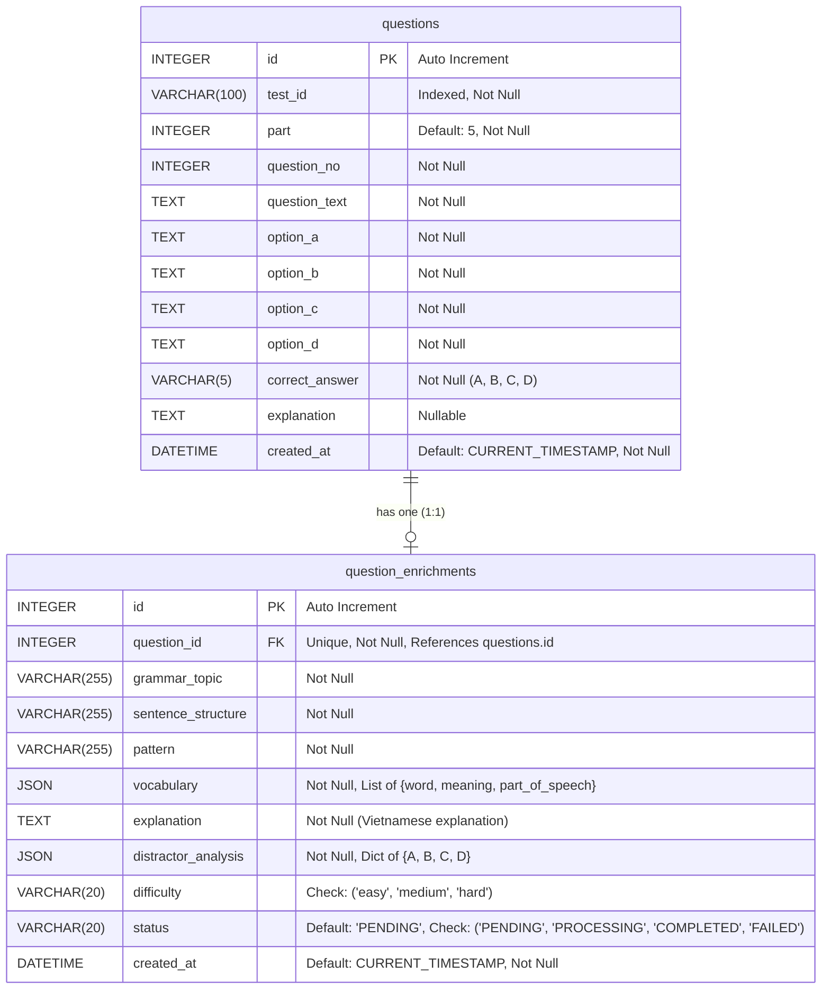
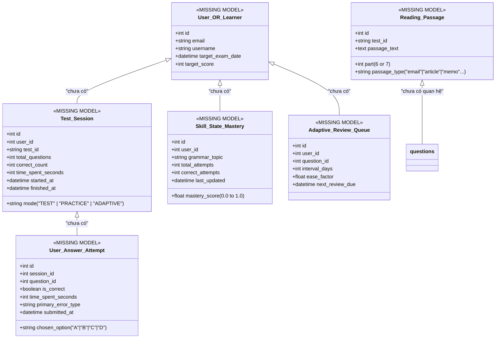

# Mô hình Dữ liệu & Cơ sở Dữ liệu Thực tế (Database & Data Model)

> **File:** `docs/system-analysis/database.md`  
> **Phương pháp phân tích:** Reverse engineering SQLAlchemy Models kết hợp kiểm tra trạng thái SQLite native (`sqlite_master`) trên tệp `toeic_agent.db` thực tế.

---

## 1. Sơ đồ Quan hệ Thực thể Thực tế (Entity Relationship Diagram)

Hệ thống cơ sở dữ liệu hiện tại chỉ bao gồm **2 bảng duy nhất** với quan hệ một - một (1-1):



---

## 2. Đối chiếu Mô hình (Model) vs Cơ sở Dữ liệu Thực tế (`toeic_agent.db`)

Dữ liệu được kiểm chứng trực tiếp thông qua truy vấn SQLite ở chế độ Read-Only (`mode=ro`) trên tệp `toeic_agent.db`:

| Bảng | Trạng thái trong Code ORM (`app/models/`) | Trạng thái thực tế trong `toeic_agent.db` | Số lượng bản ghi hiện tại | Ghi chú kiểm chứng |
|---|---|---|---|---|
| `questions` | Đã khai báo (`Question`) | **TỒN TẠI** trong `sqlite_master` | **30 bản ghi** | Chứa 30 câu hỏi Part 5 thuộc bộ đề ETS |
| `question_enrichments` | Đã khai báo (`QuestionEnrichment`) | **TỒN TẠI** trong `sqlite_master` | **0 bản ghi** | Bảng đã được tạo sẵn cấu trúc DDL, nhưng chưa lưu enrichment nào |
| `users` / `learners` | **CHƯA KHAI BÁO** | **KHÔNG TỒN TẠI** | 0 | Chưa có mô hình người dùng |
| `test_attempts` / `submissions` | **CHƯA KHAI BÁO** | **KHÔNG TỒN TẠI** | 0 | Chưa có mô hình bài làm |
| `user_answers` | **CHƯA KHAI BÁO** | **KHÔNG TỒN TẠI** | 0 | Chưa có mô hình đáp án học viên |
| `skill_mastery` | **CHƯA KHAI BÁO** | **KHÔNG TỒN TẠI** | 0 | Chưa có mô hình điểm thành thạo |
| `passages` (Part 6 & 7) | **CHƯA KHAI BÁO** | **KHÔNG TỒN TẠI** | 0 | Chưa có mô hình đoạn văn đọc hiểu |

> **Bằng chứng kiểm chứng SQLite Native:**  
> Chạy script kiểm tra an toàn `scratch/check_db_safely.py`:
> ```text
> Absolute DB Path: D:\project\Toeic_Agent\toeic_agent.db
> sqlite_master entries: [('table', 'question_enrichments'), ('table', 'questions')]
> Table 'questions' row count: 30
> Table 'question_enrichments' row count: 0
> Table 'question_enrichments': PRESENT
> ```

---

## 3. Chi tiết Cấu trúc Bảng và Ràng buộc

### 3.1. Bảng `questions`
- **Tập tin định nghĩa:** [app/models/question.py](file:///d:/project/Toeic_Agent/app/models/question.py)
- **Tên bảng:** `questions`
- **Mục đích:** Lưu trữ câu hỏi trắc nghiệm gốc và đáp án chuẩn từ đề thi.

| Tên Cột | Kiểu Dữ Liệu | Nullable | Ràng buộc / Mặc định | Ý nghĩa Nghiệp vụ |
|---|---|---|---|---|
| `id` | `INTEGER` | `NO` | `PRIMARY KEY`, Auto Increment | Khóa chính duy nhất của câu hỏi |
| `test_id` | `VARCHAR(100)` | `NO` | Index = True | Mã đề thi (vd: `"ETS_2026_TEST_01"`) |
| `part` | `INTEGER` | `NO` | Default: 5 | Phần thi TOEIC (mặc định là 5) |
| `question_no` | `INTEGER` | `NO` | None | Số thứ tự câu hỏi trong đề (vd: 101, 102) |
| `question_text` | `TEXT` | `NO` | None | Nội dung câu hỏi có chỗ trống (`______`) |
| `option_a` | `TEXT` | `NO` | None | Lựa chọn A |
| `option_b` | `TEXT` | `NO` | None | Lựa chọn B |
| `option_c` | `TEXT` | `NO` | None | Lựa chọn C |
| `option_d` | `TEXT` | `NO` | None | Lựa chọn D |
| `correct_answer` | `VARCHAR(5)` | `NO` | None | Đáp án đúng chính thức (`"A"`, `"B"`, `"C"`, `"D"`) |
| `explanation` | `TEXT` | `YES` | None | Giải thích có sẵn từ sách/đề (nếu có) |
| `created_at` | `DATETIME` | `NO` | `server_default=func.now()` | Thời điểm tạo câu hỏi |

- **Ràng buộc duy nhất toàn vẹn (Unique Constraint):**
  - Tên: `uq_test_part_question_no`
  - Cột: `("test_id", "part", "question_no")`
  - Đảm bảo trong một đề thi và một phần thi, không thể có hai câu hỏi trùng số thứ tự.
- **Quan hệ ORM:**
  - `enrichment`: Quan hệ 1-1 với `QuestionEnrichment` (`uselist=False`, `cascade="all, delete-orphan"`). Xóa câu hỏi sẽ tự động xóa bản ghi làm giàu liên quan.

---

### 3.2. Bảng `question_enrichments`
- **Tập tin định nghĩa:** [app/models/question_enrichment.py](file:///d:/project/Toeic_Agent/app/models/question_enrichment.py)
- **Tên bảng:** `question_enrichments`
- **Mục đích:** Lưu trữ hồ sơ phân tích sư phạm chuyên sâu do AI sinh ra và đã vượt qua cổng kiểm định chất lượng.

| Tên Cột | Kiểu Dữ Liệu | Nullable | Ràng buộc / Mặc định | Ý nghĩa Nghiệp vụ |
|---|---|---|---|---|
| `id` | `INTEGER` | `NO` | `PRIMARY KEY`, Auto Increment | Khóa chính |
| `question_id` | `INTEGER` | `NO` | `FOREIGN KEY(questions.id)`, `UNIQUE` | Khóa ngoại trỏ về `questions.id` (1-1) |
| `grammar_topic` | `VARCHAR(255)` | `NO` | None | Chủ điểm ngữ pháp cốt lõi |
| `sentence_structure` | `VARCHAR(255)` | `NO` | None | Công thức cấu trúc câu có chỗ trống |
| `pattern` | `VARCHAR(255)` | `NO` | None | Mẫu câu hoặc collocation có thể chuyển giao |
| `vocabulary` | `JSON` | `NO` | None | Mảng các object: `[{"word": str, "meaning": str, "part_of_speech": str}]` |
| `explanation` | `TEXT` | `NO` | None | Lời giải chi tiết tiếng Việt cho đáp án đúng |
| `distractor_analysis` | `JSON` | `NO` | None | Object chứa 4 keys: `{"A": str, "B": str, "C": str, "D": str}` |
| `difficulty` | `VARCHAR(20)` | `NO` | Check Constraint | Độ khó: `'easy'`, `'medium'`, `'hard'` |
| `status` | `VARCHAR(20)` | `NO` | Default: `'PENDING'`, Check Constraint | Trạng thái: `'PENDING'`, `'PROCESSING'`, `'COMPLETED'`, `'FAILED'` |
| `created_at` | `DATETIME` | `NO` | `server_default=func.now()` | Thời điểm tạo bản ghi làm giàu |

- **Ràng buộc mức cơ sở dữ liệu (Check Constraints):**
  - `ck_question_enrichments_difficulty`: `difficulty IN ('easy', 'medium', 'hard')`
  - `ck_question_enrichments_status`: `status IN ('PENDING', 'PROCESSING', 'COMPLETED', 'FAILED')`
- **Ràng buộc mức ứng dụng (SQLAlchemy `@validates` hooks):**
  - Các decorator `@validates` kiểm tra không được phép truyền `None` vào: `grammar_topic`, `sentence_structure`, `pattern`, `vocabulary`, `explanation`, `distractor_analysis`.
  - Validate tập giá trị hợp lệ cho `difficulty` và `status` ngay tại tầng Python trước khi gửi lệnh xuống DB.

---

## 4. Đánh giá Phạm vi Dữ liệu: Đã lưu vs Chưa có Mô hình

### 4.1. Dữ liệu ĐÃ CÓ mô hình lưu trữ hoàn chỉnh
1. **Dữ liệu Đề & Câu hỏi Part 5:** Lưu đầy đủ đề, phần, số câu, văn bản câu hỏi, 4 phương án, đáp án đúng, giải thích thô.
2. **Metadata Ngôn ngữ & Sư phạm:** Lưu đầy đủ 7 chiều thông tin sư phạm từ LLM (Grammar topic, Sentence structure, Pattern, Vocabulary JSON, Explanation, Distractor Analysis JSON, Difficulty).
3. **Trạng thái Xử lý Pipeline:** Lưu trạng thái xử lý làm giàu (`COMPLETED`, `PENDING`, `FAILED`).

### 4.2. Dữ liệu HOÀN TOÀN CHƯA CÓ mô hình lưu trữ (Khoảng trống Nghiệp vụ)



1. **Thực thể Người dùng / Học viên (`users`):** Không có bảng lưu thông tin học viên, mục tiêu điểm số hay ngày thi dự kiến.
2. **Phiên Làm bài (`test_sessions`):** Không có bảng theo dõi phiên thi (bắt đầu, kết thúc, thời gian làm bài, chế độ thi thử hay luyện tập).
3. **Lịch sử Chọn Đáp án (`user_answers`):** Không có bảng ghi nhận từng lần chọn đáp án của học viên, thời gian suy nghĩ cho từng câu, đáp án chọn so với đáp án đúng.
4. **Hồ sơ Năng lực / Kỹ năng (`skill_mastery`):** Không có bảng thống kê tỷ lệ đúng theo từng `grammar_topic` để tính điểm thành thạo (Mastery Score).
5. **Hàng đợi Ôn tập Thích ứng (`adaptive_review_queue`):** Không có bảng phục vụ thuật toán Spaced Repetition (khoảng cách ôn tập, độ dễ `ease_factor`, ngày đến hạn ôn tập).
6. **Đoạn văn Đọc hiểu Part 6 & 7 (`reading_passages`):** Hiện tại bảng `questions` chỉ chứa một văn bản câu hỏi ngắn. Các bài thi Part 6 (Text Completion) và Part 7 (Đoạn đơn, Đoạn kép, Đoạn ba) đòi hỏi một đoạn văn ngữ cảnh dùng chung cho nhiều câu hỏi; cấu trúc hiện tại chưa hỗ trợ quan hệ 1 Đoạn văn - Nhiều Câu hỏi.
