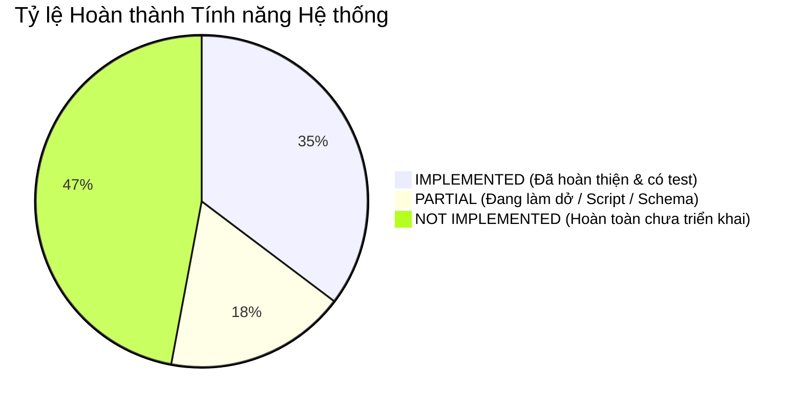
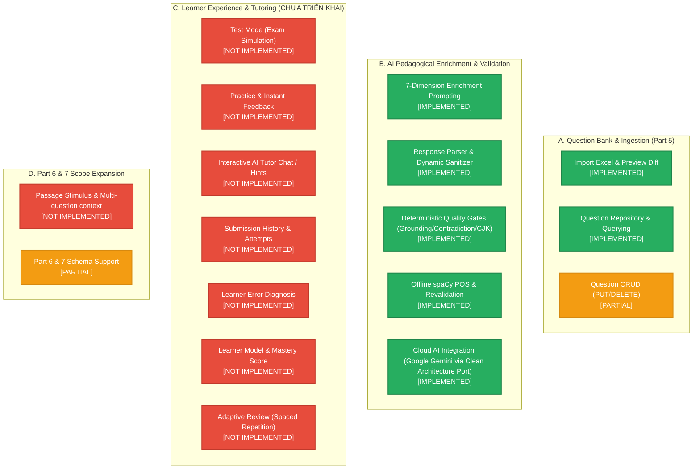

# Bảng Đánh giá Trạng thái Tính năng (Feature Status)

> **File:** `docs/system-analysis/feature-status.md`  
> **Nguyên tắc thẩm định:** Chỉ kết luận `IMPLEMENTED` khi có đầy đủ mã nguồn và test kiểm chứng; phân định rõ ràng các tính năng chưa làm hoặc làm dở dang.

---

## 1. Feature Coverage Matrix (Sơ đồ Độ phủ Tính năng)

---

## 2. Bảng Đối chiếu Tính năng Toàn diện

| Feature | Status | Evidence | Missing parts | Next action |
|---|---|---|---|---|
| **1. Quản lý đề và câu hỏi Part 5 (Import & Storage)** | `IMPLEMENTED` | [app/api/import_questions.py](file:///d:/project/Toeic_Agent/app/api/import_questions.py), [app/services/excel_parser.py](file:///d:/project/Toeic_Agent/app/services/excel_parser.py), [app/services/question_import_service.py](file:///d:/project/Toeic_Agent/app/services/question_import_service.py) | Không có thực thể riêng quản lý danh mục đề thi (`TestSet` / `ExamBundle`), `test_id` chỉ là chuỗi string thuần túy. | Chuẩn hóa bảng `tests` để quản lý metadata kỳ thi (năm, thời gian, tên sách). |
| **2. Xem trước Import & Phát hiện Xung đột (Preview & Diff)** | `IMPLEMENTED` | [app/api/import_questions.py:L20-L49](file:///d:/project/Toeic_Agent/app/api/import_questions.py#L20-L49), [app/services/excel_parser.py:L140-L521](file:///d:/project/Toeic_Agent/app/services/excel_parser.py#L140-L521) | Chưa có cơ chế upload file qua giao diện Web trực quan (mới có REST endpoint nhận binary payload). | Xây dựng giao diện web hoặc component React upload file preview. |
| **3. Cập nhật / Xóa câu hỏi trực tiếp (Individual CRUD)** | `PARTIAL` | Hỗ trợ cập nhật hàng loạt qua cờ `allow_updates=True` tại [app/services/question_import_service.py:L56](file:///d:/project/Toeic_Agent/app/services/question_import_service.py#L56) | Chưa có các endpoint RESTful đơn lẻ: `PUT /api/v1/questions/{id}`, `DELETE /api/v1/questions/{id}`. | Bổ sung router update/delete từng câu hỏi cho quản trị viên. |
| **4. Phân tích Metadata Ngôn ngữ (Grammar, Structure, Pattern, Vocab)** | `IMPLEMENTED` | [app/services/enrichment_service.py](file:///d:/project/Toeic_Agent/app/services/enrichment_service.py), [app/schemas/enrichment.py](file:///d:/project/Toeic_Agent/app/schemas/enrichment.py), [docs/ai-enrichment-prompt.md](file:///d:/project/Toeic_Agent/docs/ai-enrichment-prompt.md) | Chưa có taxonomy phân cấp chuẩn (hierarchical taxonomy) liên kết giữa các grammar topic (vd: Conjunction $\to$ Adverbial Clause). | Xây dựng ontology/taxonomy chuẩn hóa các chủ điểm ngữ pháp TOEIC. |
| **5. Phân tích Phương án Nhiễu & Giải thích (Distractor Analysis)** | `IMPLEMENTED` | [app/schemas/enrichment.py:L52-L59](file:///d:/project/Toeic_Agent/app/schemas/enrichment.py#L52-L59), [app/services/enrichment_service.py:L54-L63](file:///d:/project/Toeic_Agent/app/services/enrichment_service.py#L54-L63) | Chưa phân loại mã lỗi phương án nhiễu theo mã chuẩn hóa (vd: `WRONG_POS`, `WRONG_TENSE`, `FALSE_FRIEND`). | Bổ sung trường phân loại mã lỗi có cấu trúc (`distractor_error_code`). |
| **6. Khắc phục & Sanitize phản hồi LLM (Sanitizer)** | `IMPLEMENTED` | [app/services/enrichment_response_parser.py](file:///d:/project/Toeic_Agent/app/services/enrichment_response_parser.py), [tests/test_enrichment_response_parser.py](file:///d:/project/Toeic_Agent/tests/test_enrichment_response_parser.py) | Đã hoàn thiện: tự động gỡ codefence, xóa dấu phẩy thừa, tự map key lệch phân cấp. | Duy trì và theo dõi log để bổ sung các edge cases mới từ LLM. |
| **7. Cổng Thẩm định Chất lượng Cứng (Quality Gates)** | `IMPLEMENTED` | [app/services/enrichment_validator.py](file:///d:/project/Toeic_Agent/app/services/enrichment_validator.py), [tests/test_enrichment_validator.py](file:///d:/project/Toeic_Agent/tests/test_enrichment_validator.py) | Đã hoàn thiện: kiểm định grounding từ vựng, bắt mâu thuẫn đáp án đúng/sai, bắt rò rỉ chữ CJK, cảnh báo sư phạm. | Duy trì chất lượng; có thể thêm ngưỡng cảnh báo tỷ lệ từ vựng trùng lặp. |
| **8. Kiểm định Từ loại Ngoại tuyến (spaCy POS Consistency)** | `IMPLEMENTED` | [app/services/pos_consistency_checker.py](file:///d:/project/Toeic_Agent/app/services/pos_consistency_checker.py), [scripts/check_pos_consistency.py](file:///d:/project/Toeic_Agent/scripts/check_pos_consistency.py) | Chỉ dùng chạy offline dạng script đánh giá báo cáo; chưa được tích hợp vào pipeline runtime chính (do yêu cầu giữ spaCy tách rời app runtime). | Giữ nguyên trạng thái offline diagnostic độc lập. |
| **9. Tái thẩm định Báo cáo Ngoại tuyến (Report Revalidation)** | `IMPLEMENTED` | [app/services/report_revalidator.py](file:///d:/project/Toeic_Agent/app/services/report_revalidator.py), [scripts/revalidate_batch_report.py](file:///d:/project/Toeic_Agent/scripts/revalidate_batch_report.py) | Hoàn chỉnh cho việc replay file JSON kết quả cũ qua validator mới. | Sử dụng khi nâng cấp prompt hoặc validator để kiểm thử hồi quy. |
| **10. Hỗ trợ LLM Đám mây (Cloud LLM Integration - Google Gemini)** | `IMPLEMENTED` | [app/services/llm_client.py](file:///d:/project/Toeic_Agent/app/services/llm_client.py), [app/services/gemini_client.py](file:///d:/project/Toeic_Agent/app/services/gemini_client.py), [tests/test_gemini_client.py](file:///d:/project/Toeic_Agent/tests/test_gemini_client.py), [scripts/test_real_gemini.py](file:///d:/project/Toeic_Agent/scripts/test_real_gemini.py) | Đã chuẩn hóa Clean Architecture: loại bỏ hoàn toàn Ollama, chuyển đổi sang Google Gemini Cloud (`gemini-3.5-flash-lite`) với Port `LLMService` và Domain Exceptions (`LLMAuthenticationError`, `LLMConnectionError`, v.v.). | Tùy chọn cấu hình model Gemini hoặc rate-limit qua biến môi trường nếu cần mở rộng. |
| **11. Test Mode (Thi thử Part 5 có tính giờ & nộp bài)** | `NOT IMPLEMENTED` | Chưa tìm thấy router, schema hoặc service nào phục vụ thi thử. | Thiếu toàn bộ: session thi, tính giờ, chấm điểm tự động, giao diện nộp bài. | Tạo bảng `test_sessions`, tạo endpoint `/api/v1/tests/start` và `/submit`. |
| **12. Tutor Mode (Gia sư AI tương tác & Gợi ý)** | `NOT IMPLEMENTED` | Chưa tìm thấy router hoặc prompt hội thoại gia sư. | Thiếu: endpoint chat với gia sư, prompt sinh gợi ý từng bước (hinting) không lộ đáp án, quản lý ngữ cảnh hội thoại. | Thiết kế `TutorService` với prompt scaffolding hints. |
| **13. Lưu Lịch sử Làm bài & Câu trả lời (Submission Tracking)** | `NOT IMPLEMENTED` | Chưa có bảng hoặc service nào ghi nhận kết quả học viên. | Thiếu: bảng lưu từng lượt chọn đáp án (`user_answers`), thời gian làm bài, đáp án học viên chọn. | Tạo model `UserAnswer` và lưu vết mỗi khi học viên submit câu hỏi. |
| **14. Chẩn đoán Lỗi sai Học viên (Error Diagnosis)** | `NOT IMPLEMENTED` | Hiện chỉ có phân tích phương án nhiễu tổng quát trong `question_enrichments.distractor_analysis`, chưa gắn với câu trả lời cụ thể của học sinh. | Thiếu: engine đối chiếu đáp án học viên chọn với `distractor_analysis` để chẩn đoán khoảng trống kiến thức cá nhân. | Xây dựng `ErrorDiagnosisService` map lỗi học viên sang distractor rationale. |
| **15. Mô hình Học viên & Điểm Thành thạo (Skill State / Mastery)** | `NOT IMPLEMENTED` | Không có bảng lưu người dùng hay thống kê năng lực theo chủ điểm. | Thiếu: mô hình kỹ năng (Skill State), thuật toán tính Mastery Score (vd: BKT hoặc tỷ lệ phần trăm đúng theo chủ điểm). | Xây dựng bảng `learner_skills` và service cập nhật điểm thành thạo sau mỗi bài thi. |
| **16. Ôn tập Thích ứng (Adaptive Review / Spaced Repetition)** | `NOT IMPLEMENTED` | Không có logic hàng đợi ôn tập hay thuật toán phân khoảng thời gian (SM-2, Leitner). | Thiếu: hàng đợi câu hỏi cần ôn, thuật toán tính ngày tái hiện (next review due date). | Triển khai thuật toán Spaced Repetition dựa trên các câu học viên đã làm sai. |
| **17. Mở rộng Part 6 (Text Completion)** | `PARTIAL` | Schema `QuestionItem` và Model `Question` cho phép `part = 6` ([app/schemas/question.py:L12](file:///d:/project/Toeic_Agent/app/schemas/question.py#L12)) | Thiếu: bảng lưu đoạn văn đọc (`passages`), liên kết 4 câu hỏi vào cùng 1 đoạn văn, prompt làm giàu chưa hỗ trợ đoạn văn ngữ cảnh dài. | Thiết kế quan hệ Passage - Question và nâng cấp prompt cho Part 6. |
| **18. Mở rộng Part 7 (Reading Comprehension)** | `PARTIAL` | Schema `QuestionItem` và Model `Question` cho phép `part = 7` ([app/schemas/question.py:L12](file:///d:/project/Toeic_Agent/app/schemas/question.py#L12)) | Thiếu: hỗ trợ đoạn văn đơn/kép/ba (single/double/triple passages), hình ảnh bảng biểu, prompt làm giàu cho câu hỏi tìm chi tiết/suy luận. | Thiết kế cấu trúc dữ liệu cho văn bản đọc hiểu đa văn bản. |
| **19. Xác thực & Phân quyền Người dùng (Auth & Authorization)** | `NOT IMPLEMENTED` | Toàn bộ API hiện tại đều mở tự do (không có JWT, API key hay session cookie). | Thiếu hoàn toàn cơ chế xác thực người dùng. | Bổ sung OAuth2/JWT middleware khi phát triển tính năng cho học viên. |
