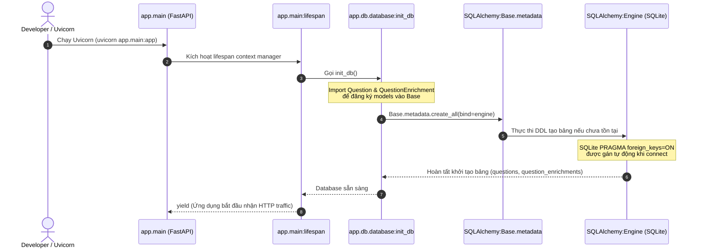
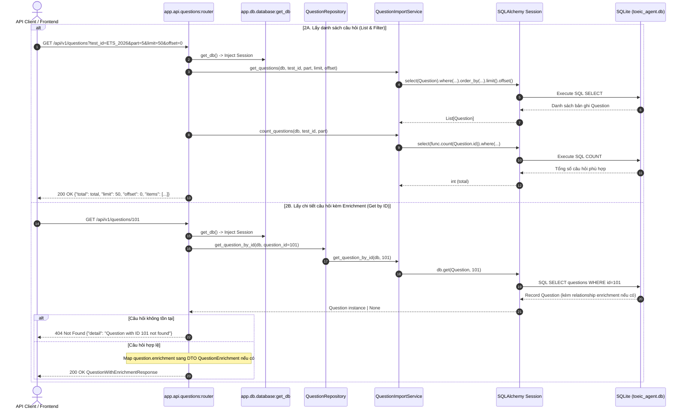
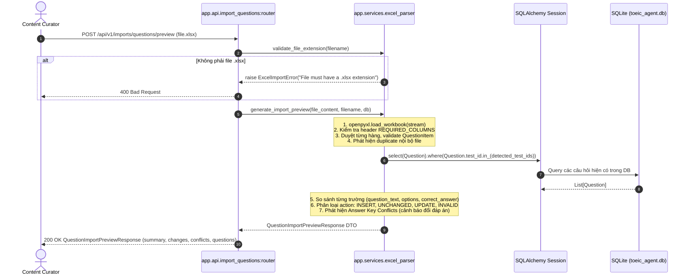
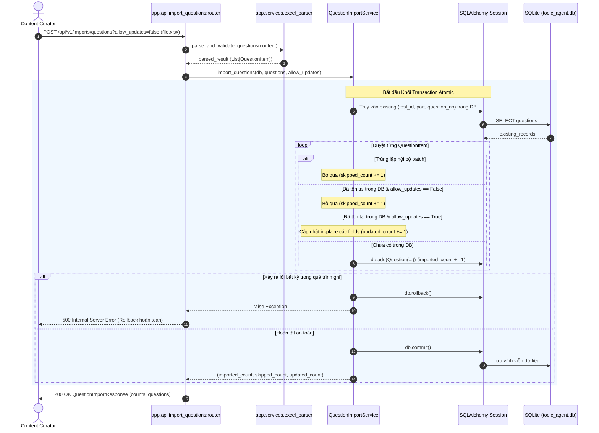
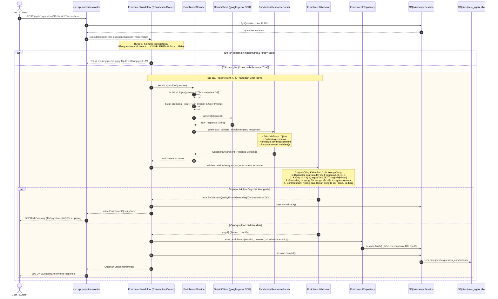
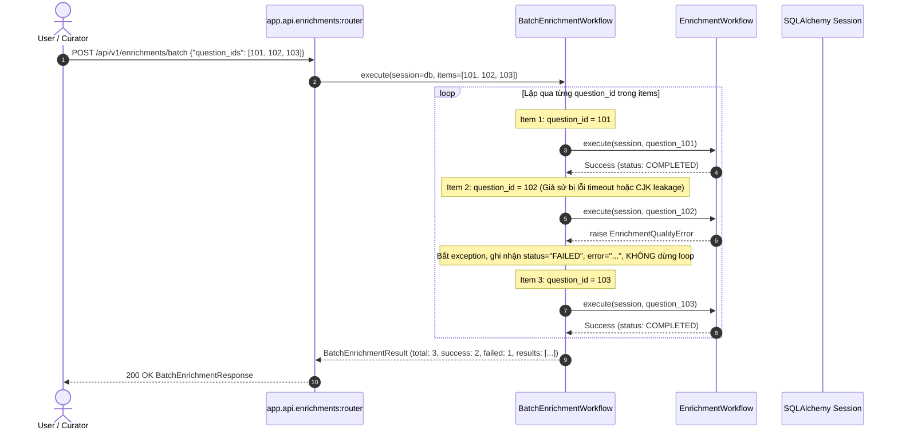
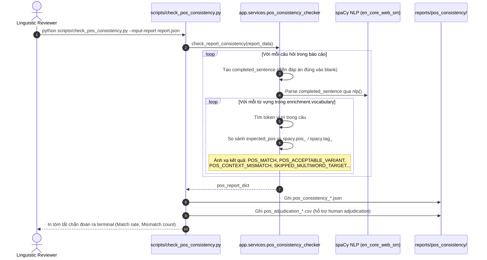

# Luồng Xử lý Thực tế của Hệ thống (System Processing Flows)

> **File:** `docs/system-analysis/flows.md`  
> **Phương pháp phân tích:** Trích xuất luồng điều khiển, thứ tự gọi hàm và cấu trúc tham số trực tiếp từ code thực thi trong `app/`.

---

## 1. Luồng 1: Khởi động Ứng dụng (Application Startup)

Luồng khởi động được định nghĩa tại `app/main.py` thông qua cơ chế `lifespan` context manager của FastAPI.

**Bằng chứng code:**
- [app/main.py:L10-L21](file:///d:/project/Toeic_Agent/app/main.py#L10-L21)
- [app/db/database.py:L15-L21](file:///d:/project/Toeic_Agent/app/db/database.py#L15-L21)
- [app/db/database.py:L39-L44](file:///d:/project/Toeic_Agent/app/db/database.py#L39-L44)

---

## 2. Luồng 2: Lấy Danh sách & Chi tiết Câu hỏi (Question Querying)

Bao gồm 2 endpoint: lấy danh sách có phân trang và lọc (`GET /api/v1/questions`) và lấy chi tiết câu hỏi kèm enrichment (`GET /api/v1/questions/{question_id}`).

**Bằng chứng code:**
- [app/api/questions.py:L36-L54](file:///d:/project/Toeic_Agent/app/api/questions.py#L36-L54)
- [app/api/questions.py:L56-L100](file:///d:/project/Toeic_Agent/app/api/questions.py#L56-L100)
- [app/services/question_import_service.py:L93-L129](file:///d:/project/Toeic_Agent/app/services/question_import_service.py#L93-L129)

---

## 3. Luồng 3: Xem trước Import & So sánh Diff (Import Preview)

Cho phép giáo viên/quản trị viên upload file Excel để xem trước các câu hợp lệ, câu lỗi, và sự khác biệt giữa file và cơ sở dữ liệu hiện tại mà **hoàn toàn không ghi đè hoặc can thiệp database**.

**Bằng chứng code:**
- [app/api/import_questions.py:L20-L49](file:///d:/project/Toeic_Agent/app/api/import_questions.py#L20-L49)
- [app/services/excel_parser.py:L140-L521](file:///d:/project/Toeic_Agent/app/services/excel_parser.py#L140-L521)

---

## 4. Luồng 4: Thực thi Import Câu hỏi Giao dịch (Atomic Ingestion)

Lưu trữ chính thức danh sách câu hỏi vào bảng `questions` với chế độ giao dịch toàn vẹn:

**Bằng chứng code:**
- [app/api/import_questions.py:L51-L95](file:///d:/project/Toeic_Agent/app/api/import_questions.py#L51-L95)
- [app/services/question_import_service.py:L11-L91](file:///d:/project/Toeic_Agent/app/services/question_import_service.py#L11-L91)

---

## 5. Luồng 5: Làm giàu AI Đơn câu & Cổng Kiểm định Chất lượng (Single Enrichment Flow)

Đây là luồng phức tạp nhất của hệ thống, kết hợp giữa mô hình ngôn ngữ và các cổng kiểm định chất lượng:

**Bằng chứng code:**
- [app/api/questions.py:L102-L177](file:///d:/project/Toeic_Agent/app/api/questions.py#L102-L177)
- [app/services/enrichment_workflow.py:L31-L80](file:///d:/project/Toeic_Agent/app/services/enrichment_workflow.py#L31-L80)
- [app/services/enrichment_service.py:L155-L161](file:///d:/project/Toeic_Agent/app/services/enrichment_service.py#L155-L161)
- [app/services/enrichment_response_parser.py:L193-L256](file:///d:/project/Toeic_Agent/app/services/enrichment_response_parser.py#L193-L256)
- [app/services/enrichment_validator.py:L587-L682](file:///d:/project/Toeic_Agent/app/services/enrichment_validator.py#L587-L682)
- [app/repositories/enrichment_repository.py:L11-L59](file:///d:/project/Toeic_Agent/app/repositories/enrichment_repository.py#L11-L59)

---

## 6. Luồng 6: Làm giàu Hàng loạt & Cô lập Lỗi (Batch Enrichment Flow)

Xử lý danh sách các câu hỏi theo thứ tự tuần tự với nguyên tắc lỗi độc lập từng câu:

**Bằng chứng code:**
- [app/api/enrichments.py:L20-L54](file:///d:/project/Toeic_Agent/app/api/enrichments.py#L20-L54)
- [app/services/batch_enrichment_workflow.py:L77-L148](file:///d:/project/Toeic_Agent/app/services/batch_enrichment_workflow.py#L77-L148)

---

## 7. Luồng 7: Giám định Ngôn ngữ Ngoại tuyến (Offline Linguistic Auditing)

Luồng kiểm định chất lượng nâng cao dành cho chuyên gia ngôn ngữ để đánh giá nhãn từ loại của LLM bằng công cụ NLP ngữ cảnh:

**Bằng chứng code:**
- [scripts/check_pos_consistency.py](file:///d:/project/Toeic_Agent/scripts/check_pos_consistency.py)
- [app/services/pos_consistency_checker.py](file:///d:/project/Toeic_Agent/app/services/pos_consistency_checker.py)

---

## 8. Đối chiếu Hành trình Người dùng: Thực tế vs Kỳ vọng

```mermaid
flowchart TD
    subgraph Current_Journey["HÀNH TRÌNH THỰC TẾ HIỆN TẠI (Admin / Curator Focus)"]
        A1["1. Chuẩn bị file Excel (.xlsx) 30-100 câu Part 5"] --> A2["2. Gọi API /imports/questions/preview để kiểm tra lỗi & diff"]
        A2 --> A3["3. Gọi API /imports/questions để import vào Question Bank"]
        A3 --> A4["4. Gọi API /questions/{id}/enrich hoặc /enrichments/batch"]
        A4 --> A5["5. Kiểm tra dữ liệu được làm giàu qua /questions/{id}"]
        A5 --> A6["6. (Tùy chọn) Chạy script spaCy đánh giá chất lượng từ vựng"]
    end

    subgraph Expected_Journey["HÀNH TRÌNH KỲ VỌNG CHO HỌC VIÊN (Learner Focus - CHƯA TRIỂN KHAI)"]
        L1["1. Học viên đăng nhập & chọn Test Mode hoặc Practice Mode"] -.-> L2["2. Hệ thống cấp đề thi hoặc câu hỏi thích ứng theo Skill State"]
        L2 -.-> L3["3. Học viên làm bài, chọn đáp án & submit"]
        L3 -.-> L4["4. Hệ thống chấm điểm, lưu lịch sử, cập nhật Mastery Score"]
        L4 -.-> L5["5. Error Diagnosis: Phân tích nguyên nhân sai dựa trên Distractor Analysis"]
        L5 -.-> L6["6. Tutor Mode: Gia sư ảo trò chuyện, đưa gợi ý (hint) & giải thích"]
        L6 -.-> L7["7. Adaptive Review: Đưa vào hàng đợi ôn tập Spaced Repetition"]
    end

    classDef current fill:#27ae60,stroke:#1e8449,stroke-width:2px,color:#fff;
    classDef expected fill:#c0392b,stroke:#922b21,stroke-width:2px,stroke-dasharray: 5 5,color:#fff;

    class A1,A2,A3,A4,A5,A6 current;
    class L1,L2,L3,L4,L5,L6,L7 expected;
```

