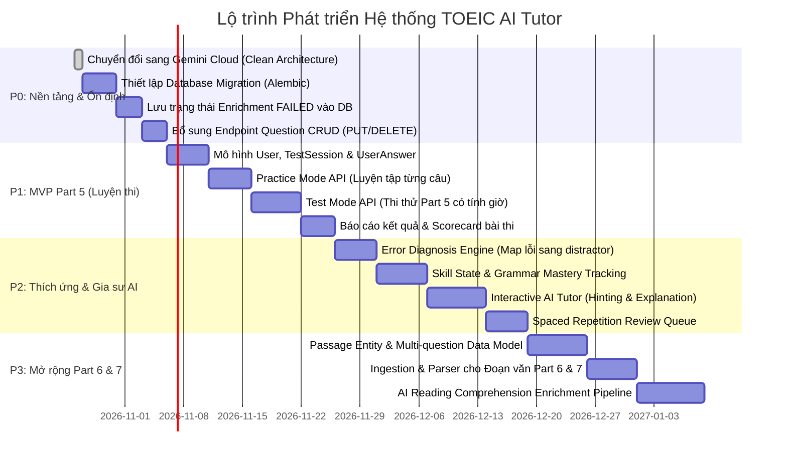

# Lộ trình Triển khai Tiếp theo (Next Steps Roadmap)

> **File:** `docs/system-analysis/next-steps.md`  
> **Nguyên tắc định hướng:** Ưu tiên từng bước nhỏ (Incremental Development), có thể kiểm thử độc lập (Testable), củng cố độ tin cậy của nền tảng hiện tại trước khi xây dựng tính năng mới.

---

## 1. Tổng quan Lộ trình Ưu tiên

---

## 2. Giai đoạn P0: Hoàn thiện Nền tảng Hiện tại (Reliability & Robustness)

*Mục tiêu: Đảm bảo pipeline Question Ingestion và AI Enrichment vận hành đáng tin cậy, linh hoạt giữa môi trường local và cloud, và có khả năng tracking lỗi chi tiết.*

### P0.1: Chuyển đổi sang Google Gemini Cloud AI & Clean Architecture Port [ĐÃ HOÀN THÀNH]
- **Kết quả thực hiện:**
  1. Loại bỏ hoàn toàn phụ thuộc vào Ollama daemon cục bộ.
  2. Tạo Port trừu tượng `app/services/llm_client.py` (`LLMService` protocol) cùng các Domain Exception độc lập với vendor (`LLMAuthenticationError`, `LLMConnectionError`, `LLMTimeoutError`, `LLMProviderError`).
  3. Xây dựng Adapter `app/services/gemini_client.py` sử dụng Google GenAI SDK (`gemini-3.5-flash-lite`), tự động nạp `GEMINI_API_KEY` từ `.env`, sanitize che giấu bí mật trong log, và ánh xạ lỗi chuẩn xác.
  4. Tích hợp trực tiếp vào `EnrichmentService` và router FastAPI `app/api/questions.py`.
  5. Đạt 100% kiểm thử tự động (349 tests passing) và kiểm thử thực tế thành công với Gemini Cloud API.

### P0.2: Thiết lập Công cụ Quản lý Database Migration (Alembic)
- **Vấn đề hiện tại:** Ứng dụng đang dùng `init_db()` với `Base.metadata.create_all(bind=engine)`. Khi bổ sung các bảng mới ở giai đoạn P1 (User, TestSession), việc cập nhật schema trên file `toeic_agent.db` hiện tại sẽ rất rủi ro nếu không có migration có phiên bản.
- **Hành động kỹ thuật:**
  1. Cài đặt `alembic` vào `requirements.txt`.
  2. Khởi tạo `alembic init alembic`.
  3. Cấu hình `env.py` trỏ vào `Base.metadata` của SQLAlchemy trong `app/db/database.py`.
  4. Tạo baseline migration đầu tiên cho 2 bảng hiện có (`questions`, `question_enrichments`).
- **Cách kiểm thử:** Chạy `alembic upgrade head` trên test database, xác nhận schema khớp 100%.

### P0.3: Lưu vết Thất bại Làm giàu (`status='FAILED'`) vào Cơ sở Dữ liệu
- **Vấn đề hiện tại:** Trong `EnrichmentWorkflow.execute`, khi quá trình sinh LLM hoặc thẩm định chất lượng thất bại, toàn bộ transaction bị rollback, dẫn đến bảng `question_enrichments` không lưu lại câu hỏi đó. Quản trị viên không thể truy vấn DB để biết những câu nào bị lỗi nếu không phân tích log server.
- **Hành động kỹ thuật:**
  1. Tách ranh giới ghi nhận trạng thái: Nếu `EnrichmentValidator` bắn ra ngoại lệ, mở một transaction độc lập ghi nhận bản ghi với `status='FAILED'`, lưu chi tiết lỗi vào cột `explanation` hoặc cột mới `error_message`.
- **Cách kiểm thử:** Giả lập response bị rò rỉ CJK hoặc không grounded từ vựng; kiểm tra trong DB xuất hiện bản ghi `status='FAILED'`.

### P0.4: Bổ sung Endpoint REST CRUD Đơn câu cho Quản trị viên
- **Vấn đề hiện tại:** Hiện chỉ có thể sửa câu hỏi bằng cách upload đè lại file Excel với `allow_updates=True`.
- **Hành động kỹ thuật:**
  1. Thêm `PUT /api/v1/questions/{question_id}`: Cho phép sửa nội dung câu hỏi, các lựa chọn hoặc đáp án.
  2. Thêm `DELETE /api/v1/questions/{question_id}`: Cho phép xóa câu hỏi (tự động xóa cascade bản ghi enrichment tương ứng).
- **Cách kiểm thử:** Viết 4 unit tests kiểm tra sửa thành công, sửa câu không tồn tại (404), xóa thành công và xóa cascade.

---

## 3. Giai đoạn P1: Hoàn thành MVP Part 5 (Luyện thi & Chấm điểm)

*Mục tiêu: Đưa hệ thống từ công cụ quản lý câu hỏi trở thành ứng dụng mà học viên thực sự có thể làm bài thi và luyện tập.*

### P1.1: Xây dựng Mô hình Thực thể Người dùng & Phiên làm bài
- **Mô hình cần thêm:**
  - `User` (`id`, `username`, `email`, `created_at`).
  - `TestSession` (`id`, `user_id`, `test_id`, `mode`, `total_questions`, `correct_count`, `time_spent_seconds`, `started_at`, `submitted_at`).
  - `UserAnswer` (`id`, `session_id`, `question_id`, `chosen_option`, `is_correct`, `time_spent_seconds`).
- **Cách kiểm thử:** Viết migration Alembic tạo 3 bảng; viết repository persistence tests.

### P1.2: Triển khai Practice Mode API (Luyện tập Tức thì)
- **Mục tiêu:** Cho phép học viên luyện từng câu và xem ngay giải thích sư phạm chất lượng cao.
- **Endpoints cần tạo:**
  - `GET /api/v1/practice/questions/random?topic=...`: Lấy ngẫu nhiên câu hỏi (ưu tiên các câu đã có enrichment).
  - `POST /api/v1/practice/questions/{question_id}/submit`:
    - Body: `{"chosen_option": "A", "time_spent_seconds": 25}`.
    - Xử lý: So sánh `chosen_option` với `Question.correct_answer`.
    - Trả về: Đúng/Sai, đáp án chuẩn, lời giải thích (`explanation`), phân tích phương án nhiễu (`distractor_analysis`), từ vựng cốt lõi (`vocabulary`).
- **Cách kiểm thử:** Test học viên chọn đúng nhận feedback chúc mừng; chọn sai nhận lý do vì sao phương án đã chọn bị loại.

### P1.3: Triển khai Test Mode API (Thi thử Part 5 Có Bấm giờ)
- **Mục tiêu:** Mô phỏng phòng thi thật cho 30 câu Part 5 với áp lực thời gian (khuyến nghị 15 - 20 phút).
- **Endpoints cần tạo:**
  - `POST /api/v1/tests/start`: Khởi tạo phiên làm bài cho một đề cụ thể (`test_id`), trả về danh sách câu hỏi (ẩn đáp án đúng).
  - `POST /api/v1/tests/sessions/{session_id}/submit`: Nộp toàn bộ bài thi dạng mảng câu trả lời `[{"question_id": 101, "chosen_option": "B"}, ...]`.
  - `GET /api/v1/tests/sessions/{session_id}/scorecard`: Xem bảng điểm tổng kết (Số câu đúng/sai, điểm số ước tính TOEIC Reading, thời gian làm trung bình mỗi câu).
- **Cách kiểm thử:** Chạy test toàn bộ luồng từ tạo phiên $\to$ nộp bài $\to$ kiểm tra kết quả chấm điểm chính xác.

---

## 4. Giai đoạn P2: Thích ứng & Trải nghiệm Gia sư AI (Adaptive AI Tutor)

*Mục tiêu: Cá nhân hóa trải nghiệm học tập, tận dụng tối đa dữ liệu enrichment để phát hiện điểm yếu và kèm cặp học viên.*

### P2.1: Chẩn đoán Lỗi sai Học viên (Error Diagnosis Engine)
- **Mục tiêu:** Tự động chỉ ra nguyên nhân bản chất vì sao học viên chọn sai.
- **Cách thức hoạt động:**
  - Khi học viên chọn phương án sai (ví dụ chọn C), engine trích xuất chuỗi giải thích tương ứng trong `QuestionEnrichment.distractor_analysis["C"]`.
  - Phân loại lỗi theo nhóm kiến thức: *Nhầm từ loại (POS Confusion)*, *Sai thì của động từ (Tense Mismatch)*, *Bẫy từ vựng đồng nghĩa (Vocabulary Trap)*.
- **Cách kiểm thử:** Viết unit test xác minh learner sai phương án nào thì nhận đúng giải thích của phương án đó.

### P2.2: Mô hình Điểm Thành thạo Ngữ pháp (Grammar Skill State & Mastery Score)
- **Mục tiêu:** Định lượng năng lực của học viên theo từng chuyên đề ngữ pháp.
- **Hành động kỹ thuật:**
  - Tạo bảng `learner_grammar_mastery` (`user_id`, `grammar_topic`, `total_attempts`, `correct_attempts`, `mastery_score`).
  - Sau mỗi bài nộp, cập nhật điểm thành thạo theo công thức trung bình trượt có trọng số (exponential moving average).
  - API `/api/v1/analytics/mastery-report`: Trả về danh sách các chủ điểm học viên còn yếu (mastery < 60%) để tập trung ôn tập.

### P2.3: Gia sư AI Tương tác (Interactive Tutor Hints & Chat)
- **Mục tiêu:** Hỗ trợ học viên trong lúc làm bài mà không làm lộ đáp án (Scaffolding).
- **Endpoints cần tạo:**
  - `POST /api/v1/tutor/hint`: Nhận câu hỏi và blank; LLM tạo ra một câu gợi ý định hướng (vd: *"Hãy chú ý từ 'important' đứng ngay sau chỗ trống là tính từ, trước tính từ ta cần từ loại gì?"*).
  - `POST /api/v1/tutor/chat`: Cho phép học viên hỏi sâu về câu văn (vd: *"Tại sao câu này không dùng hardly?"*).

### P2.4: Hàng đợi Ôn tập Thích ứng (Spaced Repetition Review Queue)
- **Mục tiêu:** Ngăn chặn đường cong lãng quên (Forgetting Curve) của học viên.
- **Hành động kỹ thuật:**
  - Thuật toán lên lịch ôn tập cho các câu làm sai: Lần 1 sau 1 ngày, lần 2 sau 3 ngày, lần 3 sau 7 ngày.
  - API `/api/v1/learners/me/review-due`: Cung cấp danh sách các câu hỏi đến hạn cần ôn lại hôm nay.

---

## 5. Giai đoạn P3: Mở rộng Phạm vi Sang Part 6 và Part 7

*Mục tiêu: Đưa hệ thống bao phủ toàn bộ phần thi TOEIC Reading (Parts 5, 6, 7).*

### P3.1: Mô hình Thực thể Đoạn văn Đọc hiểu (`ReadingPassage`)
- **Đặc điểm Part 6 & 7:** Câu hỏi không đứng độc lập mà phụ thuộc vào một hoặc nhiều đoạn văn (Email, Thư mời, Bài báo, Tin nhắn đối thoại).
- **Mô hình đề xuất:**
  - `ReadingPassage` (`id`, `test_id`, `part`, `passage_type`, `passage_text`, `image_url`).
  - Cập nhật bảng `questions`: Thêm cột `passage_id (FK)` nullable.

### P3.2: Nâng cấp Parser & Quy chuẩn Input Excel cho Part 6 & 7
- Hỗ trợ nhập liệu cấu trúc phân cấp: 1 Đoạn văn $\to$ 4 câu hỏi trắc nghiệm liên quan.

### P3.3: Nâng cấp Prompt Làm giàu cho Câu hỏi Đọc hiểu
- Mở rộng prompt sư phạm để phân tích:
  - Vị trí bằng chứng thông tin trong bài đọc (Contextual Clue / Line Citation).
  - Phân loại kỹ năng đọc: *Tìm ý chính (Main Idea)*, *Tra cứu thông tin chi tiết (Fact Retrieval)*, *Suy luận ý ngầm (Inference)*, *Từ đồng nghĩa trong văn cảnh (Vocabulary in Context)*.
